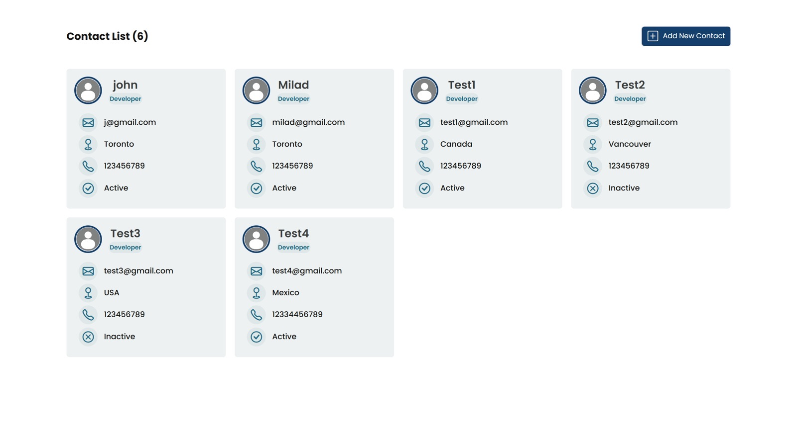

<div align="center">

# 📇 Contact API App

A full-stack contact manager with a React frontend and a Spring Boot and PostgreSQL API.

<a href="https://github.com/miladmo68/Contact-API-App"></a>
<a href="https://miladweb.com"></a>

</div>

<p align="center">
  
</p>

## ✨ Features

- Create, view, update and delete contacts
- Photo upload per contact
- Spring Boot REST API with PostgreSQL

## 🛠️ Tech Stack

     

> [!NOTE]
> This project needs its own backend, database or API keys, so it runs locally rather than as a static demo.

## 🚀 Getting Started

**Prerequisites:** [Node.js](https://nodejs.org/) 18 or newer · Java 17+ (the Maven wrapper is included)

**Clone**

```bash
git clone https://github.com/miladmo68/Contact-API-App.git
cd Contact-API-App
```

**Backend (contactapi-back)**

```bash
cd contactapi-back
./mvnw spring-boot:run
```

**contactapp-front**

```bash
cd contactapp-front
npm install
npm start
```

## 📡 API Endpoints

| Method | Path |
| --- | --- |
| `POST` | `/contacts` |
| `GET` | `/contacts` |
| `GET` | `/contacts/{id}` |
| `PUT` | `/contacts/photo` |

## 📁 Project Structure

```
Contact-API-App/
├── contactapi-back/
└── contactapp-front/
```

## 👤 Author

**Milad Mohammadi** — Frontend-Focused Full-Stack Developer, Toronto 🇨🇦

[](https://miladweb.com)
[](https://www.linkedin.com/in/miladmo68/)
[](https://github.com/miladmo68)

<p align="center"><sub>If you like this project, consider giving it a ⭐</sub></p>
